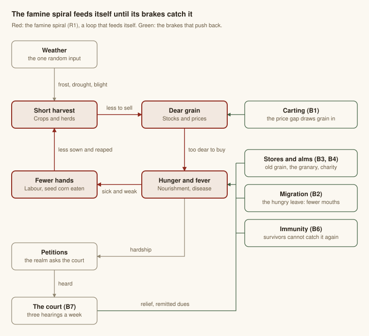

# Vicarius Regis — The Living Realm: Simulation Design

Nov 26, 2026 · Exported from the [Claude Doc](https://claude.ai/artifact/HejEULhYmPgyQz9c882bHT) of the same name. Once building starts, treat this file as the source and keep it current.

## Summary and recommendation

Rebuild the simulation from scratch; keep the court. The player still hears three petitions a week, rules grant, alternative or deny, and keeps the court's standing until the king returns in week 52. Everything beneath the docket is replaced by a living realm in which weather, harvests, prices, disease, unrest, belief, kinship and politics determine one another.

Petitions become the realm speaking about what is actually happening to it. A frost in week 9 can, through the barley crop, the price of bread, a hungry winter and a fever in the crowded Capital, bring a weaver to the court in week 30 asking for alms. Nobody writes that story.

Why start fresh rather than refactor:

- The current game (`index.html`) draws petitions from about 100 authored kinds keyed to state. Moving them around cannot make them emergent.
- The `core/` prototype proved that a closed set of primitives produces recognisable situations. But its world is abstract: pressure is an input, not a consequence, and there is no material base.
- A material simulation has to be the foundation. Pressure, needs and grievance become readouts of it, so they cannot be bolted on afterwards.

What carries over is the player's loop (audience, three hearings, rulings, standing), the visual language, and the design lessons of the prototype.

The design is deliberately open. Whatever completeness or historical precedent warrants can be added later through one admission test, without rebuilding what exists.

The rule for the whole project: nothing happens because it was scheduled; everything happens because something else did.

## Pillars

Nine rules govern every system. When a design question is unclear, these decide it.

1. **Everything is caused.** Every change of state traces to something else in the simulation: a frost, a price, a death, a ruling. There is no event table, no scheduled crisis and no weekly roll for "something happens".
2. **Chance enters only at the boundary.** Randomness lives only where the world beyond the realm touches it: the weather, sickness from abroad, raiders. Every draw is seeded and logged, and its odds are shaped by the realm's own state.
3. **The realm acts without you.** Households sell, borrow, hoard, migrate, pray, marry, steal and riot on their own. The court is one remedy among several, not the engine of events.
4. **The player acts only through hearings.** Three hearings a week, four at a cost in standing, are the whole of the player's reach. Households learn what the court grants and change what they ask for.
5. **Nothing is authored.** No petition, event or line of text belongs to a named situation. Flavour is composed from the causes that produced the petition.
6. **Every number answers "why?"** Each derived value keeps a ledger of its largest causes. The screen can always say why bread is dear or why a household is desperate.
7. **Blandness means a missing system.** If the realm feels flat, deepen or add a system. Never write an event to fill the gap.
8. **Every reinforcing loop has a balancing partner.** Famine spirals meet migration, charity and death; panics meet explanation. The realm can collapse, but not by default.
9. **The realm stays open to addition.** Anything that completeness or historical precedent warrants can be added: a system, a good, a disease, an institution, a tie, a binding, a motive. Each addition joins the causal web like everything else; nothing is ever added as an event.

## What stays, what goes

The player's side of the game survives; the machinery under it is replaced. Each element falls into one of three groups.

### Kept as it is

| Element | As it works today |
| --- | --- |
| The reign | 52 weeks. The king returns at the close, and the reign is kept if any standing remains. |
| The calendar | Four quarter days: Lady Day (week 7), Midsummer (20), Michaelmas (34) and Christmas (46). |
| Audience and docket | Petitioners wait in an audience. The player hears 3 a week, or 4 by spending 2 standing. |
| Rulings | Grant, an alternative, or deny. Each option shows its effects before it is chosen. |
| Standing | 10 seals. A breach of confidence costs 4, standing recovers at most 2 a week, and the reign falls at 0. |
| Breaches | A constituency breaches when its grievance reaches the line (3 today). |
| Regions and estates | Capital, Highlands, Riverlands. Noble, Cleric, Official, Merchant, Soldier, Commoner. |
| Named households | Petitioners are named households with kin, holdings and memory. |
| The visual language | Cards, pressure pips, regard graph, binding boxes, rule and law plates, shields, rings, tiles. |
| The platform | A static web app that runs offline in a browser. |

### Kept, rebuilt underneath

| Element | Today | In the new simulation |
| --- | --- | --- |
| Pressure | A 0–8 count raised by burdens and eased by rulings | A readout of a household's weeks of cover: stocks, coin and income against food and dues |
| Needs | Bars from −8 to +6 that grow on quarter days | Provision ratios: how much of what a purpose requires actually arrives |
| Duties and shares | Abstract units split among households by weight | Labour-weeks and goods owed, split by weight |
| Grievance | Accumulates from burden and neglect | Accumulates from members' real hardship, unheard petitions, rulings and broken bindings |
| Relationships and bindings | Words, compacts, ordinances, rules, laws | The same vocabulary; tests may now read material conditions |
| Devotion and superstition | Measures nudged by rulings | Moved by suffering, consolation, scandal and unexplained anomalies |
| Esteem and rivalry | Ties between estates and their members | The same, now driven by who gains and who pays |
| Rules and laws | Precedents and statutes | The same, and laws now change economic rules: prices, tolls, usury |
| Offices, garrisons, readiness | Titles and a readiness count | Garrisons that must be fed and paid; readiness falls with hunger and arrears |

### Retired

- The \~100 authored petition kinds and their sequels.
- Hallway matters.
- Abstract pressure arithmetic: hand-set rates, capacities and seasonal drifts.
- Event pools of any kind.

### References

- `index.html`: the current game. It stays playable until the new one surpasses it.
- `core/`: the primitives prototype, with its bindings engine, petition grid, flavour composer and emergence checks. `core/README.md` lists its vocabulary.

## World model

The realm is a stack of physical layers, each feeding the next. Every quantity is something you could count, weigh or ask about; pressure, need and grievance are read off the stack rather than stored as inputs.

### Layers

| Layer | What it holds | What moves it |
| --- | --- | --- |
| Sky | Season, temperature, rainfall, the running anomaly | The calendar and the weather draw |
| Land | Fields, pasture, woodland, soil, the river, built works | Weather, labour, works, floods |
| Living things | Crops, herds, the health of people, disease | Growth, nourishment, contagion |
| Goods | Stocks, prices, coin, debts | Production, trade, consumption, theft |
| Society | Households, cohorts, kin, grievance, unrest | Hardship, self-help, rulings |
| Polity | Court, estates, offices, duties, laws, bindings | Rulings, precedent, breaches |
| Mind | Devotion, superstition, rumour, memory, expectations | Everything above |

### Entities

| Entity | Count | Key state |
| --- | --- | --- |
| Realm | 1 | Week, standing, laws in force, the Crown's purse and granary if adopted |
| Region | 3 | Terrain, climate, river, market, built works, disease, unrest |
| Cohort | 18 (3 regions × 6 estates) | Workers and dependants, holdings, stocks, coin, nourishment, health, grievance |
| Household | 24–48, named | Members, holdings, stocks, coin, debts, duties, kin, ties, memory, expectations |
| Work | about 15 | Kind (levee, road, wall, granary, wells and drains, bridge), condition 0–1, capacity |
| Route | 3–6 | Ends, carrying capacity, cost, danger |
| Duty | 10–15 | Purpose, region, what it requires, who carries which share |
| Binding | open | Kind, parties, tests, span, effects |
| Tie | open | Kind (kin, owes, charge, grudge, esteem, rivalry), parties, weight |
| Office | 6–10 | Title, holder, powers, duties |

A cohort is everyone in a region and estate who is not a named household, simulated in aggregate. Named households belong to a cohort and face its weather, prices and duties, but differ in holdings, debts, kin and memory. Petitions come from named households; the numbers in them come from cohorts.

### Regions

| Region | Character | Lives by | Exposed to |
| --- | --- | --- | --- |
| Capital | Crowded walled city, seat of the court | Trade, crafts, offices, imported grain | Fever from bad water, bread prices, riot |
| Highlands | Cold uplands, thin soil, the border | Sheep, wool, timber, oats | Hard winters, snow-blocked roads, raiders |
| Riverlands | Fertile floodplain along the river | Wheat, barley, river trade | Floods, blight, summer fever |

Rain in the Highlands raises the river in the Riverlands a week later. Riverlands grain feeds the Capital; Highlands wool feeds its weavers. Each region depends on the others.

### What the estates hold and owe

| Estate | Holds | Lives on | Owes |
| --- | --- | --- | --- |
| Noble | Land, herds, halls | Rents and dues from tenants | Armed service, Crown dues |
| Cleric | Church land, churches, the hospital | Tithe, alms, fees | Worship, charity, care of the sick |
| Official | Offices | Fees and salaries | Justice, collection, administration |
| Merchant | Stocks, coin, carts and barges | Trade margins, loans | Tolls, Crown dues |
| Soldier | Arms, billets | Pay and provisions | Watch, garrison, the field |
| Commoner | Tenancies, tools, small herds, crafts | Their own produce, wages | Rent, tithe, labour on works |

These flows are the economy's skeleton. A bad harvest cuts rents, which cuts noble purchases, which idles weavers. Nothing is linked by hand.

### Scale and units

The proposed realm holds about 14,000 souls: 6,000 in the Capital, 3,000 in the Highlands, 5,000 in the Riverlands. Commoners are about 85% of them.

| Quantity | Unit |
| --- | --- |
| Time | Week; 52 to the year |
| Food | Ration: one adult's food for a week. A bushel of grain is about 6 rations. |
| Labour | Worker-week |
| Money | Pence (12 to the shilling, 240 to the pound) |
| Land | Acres |
| Health, nourishment, condition | 0 to 1 |

## Systems I: the material base

Five systems produce the realm's food, health and labour. Everything social and political later in this document reads from them.

Each system below gives its state, its weekly rule, what it feeds, the court's levers, and what should emerge from it unprompted.

### Climate and weather

Weather is a seasonal baseline plus a persistent anomaly, so wet years and droughts come in runs rather than single bad weeks. The anomaly is the only place the sky is random.

Each region carries a temperature anomaly and a rain anomaly. Each week they decay toward zero and take a new shock: a realm-wide draw shared by all regions, plus a regional one.

```math
a_{r,t} = 0.8\,a_{r,t-1} + 0.6\,z_{t} + 0.4\,z_{r,t}
```

```math
T_{r,t} = \bar{T}_r(w) + \sigma_T\,a^{T}_{r,t} \qquad R_{r,t} = \bar{R}_r(w)\,e^{\sigma_R\,a^{R}_{r,t}}
```

Here the z values are standard normal draws, and the barred terms are each region's seasonal baseline for week w. Soil moisture, snow cover, frost, drought and wetness are derived from the running totals, never drawn.

- **Feeds:** crop growth, frost and blight; the river; disease; roads; building works; superstition.
- **Levers:** none over the sky. The court prepares through levees, granaries, stores and seed reserves.
- **Emerges:** droughts, wet summers, runs of hard winters, and a Highland storm that floods the Riverlands a week later.

### Land and built works

Land holds fields, pasture, woodland and soil fertility; the built works decide how well people withstand the weather. Every work has a condition from 0 to 1 that decays and must be repaired with labour and materials.

| Work | What its condition sets | Decays faster with |
| --- | --- | --- |
| Levee | The river level that floods the plain | Floods, neglect |
| Road and bridge | Route capacity and travel time | Rain, snow, heavy carting |
| Wall | Defence against raiders | Neglect, siege |
| Granary | Spoilage of stored grain | Damp, rats, neglect |
| Wells and drains | Clean water, and so waterborne disease | Floods, crowding |

The river rises with Highland runoff from the week before and local runoff this week. When it tops the levee, the flood takes standing crops, stored grain, herds and road condition, and fouls the wells.

```math
L_{t} = L_0 + k_H\,\text{runoff}^{\text{High}}_{t-1} + k_R\,\text{runoff}^{\text{River}}_{t}
\qquad \text{flood when } L_t > C_{\text{levee}}\cdot c_{\text{levee}}
```

Fertility falls with continuous cropping and recovers with fallow and manure, so it changes once a year.

- **Feeds:** harvests, stores, trade, disease, defence.
- **Levers:** works duties, ordering repairs, funding works from the purse, tolls to pay for roads.
- **Emerges:** a flood when storms meet a neglected levee; exhausted soil after hungry years force fallow into crop.

### Crops and herds

Harvests are grown week by week from the weather, the labour and the seed actually available. The farming calendar is fixed; its outcome is not.

| Weeks | Season | Work |
| --- | --- | --- |
| 4–12 | March–April | Spring ploughing; barley and oats sown |
| 13–25 | May–July | The hungry gap: last year's grain runs low |
| 17–20 | June | Shearing; the Highland wool clip |
| 20–25 | Late June–July | Haymaking for winter fodder |
| 25–31 | August–mid-September | The grain harvest |
| 34–38 | October | Winter wheat sown |
| 40 | Martinmas | Slaughter of beasts that cannot be fed |

Each week a growing crop gains growth from temperature and moisture bands. Frost kills tender crops, and warm wet weeks build a blight index.

```math
g_t = g_T(T_t)\cdot g_m(m_t) \qquad G = \frac{\sum_t g_t}{\sum_t \bar{g}_t}
```

```math
Y = A \cdot y_0 \cdot f \cdot G \cdot \min\!\left(1,\ \frac{L_h}{L_h^{*}}\right) \cdot (1-b)\,(1-\phi)
```

A is the acres sown, y₀ the base yield, f fertility, Lₕ the harvest labour against what is needed, b blight and φ the share lost to flood. Seed for next year comes out of this harvest, at roughly one bushel in four.

Herds need pasture in summer and hay in winter. A short hay crop forces early slaughter: meat is cheap this winter, and herds and ploughing oxen are fewer next year.

- **Feeds:** food stocks, prices, rents, the wool trade, seed, ploughing capacity.
- **Levers:** seed loans, remitting rents, labour for the harvest, fodder purchases.
- **Emerges:** the hungry gap; good and bad years; a family that eats its seed corn and has a second bad year.

### People, food and labour

People are counted as workers and dependants, each cohort with a nourishment and a health from 0 to 1. Hunger lowers work, raises sickness and, past a point, kills.

Each week every household and cohort tries to eat. It draws in order on its own stocks, the market, wages paid in kind, and charity; then it sells beasts or tools, eats seed corn, or goes short.

```math
n_t = 0.7\,n_{t-1} + 0.3\,\frac{\text{eaten}_t}{\text{needed}_t} \qquad \text{labour} = \text{workers}\cdot h \cdot (0.5 + 0.5\,n)
```

Labour goes first to the household's own fields in season, then to duties owed, then to wages and crafts. Wages follow the balance of labour wanted against labour available, so deaths raise them. Births and deaths run at medieval rates, moved by nourishment and disease; dependants grow into workers slowly.

- **Feeds:** production, duties, wages, disease, unrest, migration.
- **Levers:** relief, alms, wage rules, labour duties, remitted dues.
- **Emerges:** harvests lost for want of hands; wages that climb after a fever, and landlords who petition to cap them.

### Health and disease

Disease spreads when conditions let it, not when a table says so. Three human diseases and one of beasts cover the realm's sicknesses.

| Disease | Season | Spreads with | Strikes hardest |
| --- | --- | --- | --- |
| Summer fever | Warm months | Fouled water, floods, crowding | Capital, Riverlands |
| Winter cough | Cold months | Crowding indoors, hunger | The old, the starving |
| Pestilence | Any; worst in warmth | Trade and travellers from abroad | Wherever routes reach |
| Murrain | Any | Herds moving to market | Highland and Riverland herds |

Each region runs a susceptible, infected and recovered count for each disease. Fever and cough keep a small reservoir, so an outbreak begins exactly when conditions push their spread above replacement.

```math
\Delta I = \beta\,\frac{S\,I}{N} - (\gamma + \mu)\,I \qquad \beta = \beta_0 \cdot \kappa_{\text{crowd}} \cdot (1+s) \cdot \sigma(w) \cdot \frac{1}{n} \cdot \nu
```

Crowding, the sanitation deficit s, the season, poor nourishment and movement ν raise spread. Pestilence alone arrives by a draw, with odds that rise with trade through the routes; this is one of the designated random points.

The sick cannot work, and the dead leave heirs, debts, widows and empty offices. Deaths beyond what people expect raise fear and superstition; those with means flee the Capital, and markets thin.

- **Feeds:** labour, wages, inheritance, prices, superstition, devotion, grievance, migration.
- **Levers:** quarantine (cuts trade), cleaning wells, relief, funding the hospital, banning fairs and processions.
- **Emerges:** fever after a flood fouls the wells; cough in a hungry Capital winter; a procession that comforts the faithful and spreads the sickness.

## Systems II: economy, obligations and security

These three systems move goods, coin and protection between people. They turn the material base into winners, losers and grievances.

### Economy and markets

Prices come from what people actually offer and want, region by region. Goods are kept few: grain, beasts and meat, wool, cloth, timber and stone, and coin.

Each region has one market. Holders offer what exceeds the reserve they want to keep, and that reserve grows when they expect scarcity. Buyers bid up to what their coin allows.

```math
p_{g,r,t} = p^{\text{ref}}_{g}\left(\frac{D_{g,r,t}}{S_{g,r,t}}\right)^{\varepsilon_g} \qquad \text{keep} = \text{use} \times \big(k_0 + k_1\,\hat{\pi}\big)
```

Here π̂ is the scarcity a holder expects, learned from rumour, the price trend and the harvest outlook. Grain demand is inelastic: a tenth short should raise the price by about a third, as in Gregory King's old rule of thumb.

Merchants carry goods between regions while the price gap exceeds the cost of carting, tolls and risk on the route. Route capacity and merchant capital limit how much moves. Beyond the border lies an outside market whose prices drift on their own.

```math
\text{carry } r \to r' \quad \text{while} \quad p_{r'} - p_{r} > c_{\text{route}} + \text{toll} + \text{risk}
```

Credit runs through merchants and the church. A debt has a principal, a rate, a due date, a security and sometimes a surety. A default lets the creditor seize the security, roll the debt at a worse rate, or come to court; a creditor whose debtors default may default in turn.

The Crown takes dues on land and trade through its officials. Whether those dues fill a purse and a granary the court can spend is a decision still to make.

- **Feeds:** who eats, rents, wages, the wealth of each estate, debts, hoarding, theft, grievance.
- **Levers:** a price assize, an export ban, opening the granary, remitting dues, licences, deferring debts, a rule on usury, tolls.
- **Emerges:** prices that climb through the hungry gap; hoarding before a shortage; grain carted to the Capital while the Riverlands go hungry; merchants who grow rich on a famine; debt cascades.

### Obligations and duties

Duties are what each purpose of the realm requires, measured in labour and goods, and split among those who owe them. Needs become provision ratios: how much of the requirement actually arrives.

| Duty | Purpose | Requires | Falls on |
| --- | --- | --- | --- |
| Provisioning | Feed and billet the garrison | Rations, beds | The region's households |
| Relief | Feed the poor | Rations or coin | Church, nobles, guilds |
| Works | Build and repair the works | Worker-weeks, timber and stone | Commoners' labour, nobles' materials |
| Watch | Keep order and guard the walls | Worker-weeks | Townsmen, soldiers |
| Tithe | Keep the church | A tenth of produce | Every producer |
| Dues | Keep the Crown | Coin or kind | Holders of land and trade |

```math
\text{share}_i = \text{required} \cdot \frac{w_i}{\sum_j w_j} \qquad \text{provision} = \frac{\text{delivered}}{\text{required}}
```

Weights come from law, custom and rulings. Each household delivers the lesser of its share and what it can spare, and withholds more when aggrieved or desperate.

Requirements follow the year: the muster at Lady Day, building in summer, relief in winter. That replaces today's quarter-day growth with growth that has a cause. A shortfall harms the purpose itself: the garrison goes hungry, the levee decays, the poor starve, the streets go unwatched.

- **Feeds:** readiness, works condition, hunger, order, the church's means, the Crown's means.
- **Levers:** exemptions, transfers of a share, new duties, commuting labour into coin.
- **Emerges:** a household broken by its share in a bad year; a duty quietly withheld by an aggrieved estate.

### Security and order

Order is kept by fed, paid soldiers and watchmen, and broken by desperate people and raiders. Bandits are people from the realm itself, not a spawn.

Each region's garrison has provisions, pay, arrears and health; readiness follows them. Unpaid or hungry soldiers desert, plunder the households they are billeted on, or petition in a body.

Banditry grows on each route from the desperate: the hungry, the landless, deserters and discharged soldiers. Patrols, pardons and hangings shrink it. Bandits raise the risk and cost of carting and steal from stores.

Raids from beyond the Highland border are a designated random draw. The odds rise after harvest and with poor walls, low readiness and disorder in the realm, and fall in deep winter.

- **Feeds:** trade costs, stores, deaths, fear, grievance, the soldiers' estate.
- **Levers:** pay and feed the garrison, raise the watch, repair walls, pardon or hang, muster levies from the fields.
- **Emerges:** bandits a season after a famine; deserters after an unpaid winter; raids when the walls are poor and the garrison hungry; merchants asking for escorts.

## Systems III: households, society, belief and politics

These systems turn material hardship into human action: choices, grudges, prayers, riots and petitions. They are where the court's rulings land.

### Households

A named household is a small economy with a memory. It holds members, land or a trade, stocks, coin, debts, duty shares, ties to others, attitudes, a ledger of what was done to it, and expectations of the court.

Pressure is read, never set. It measures weeks of cover, then adds for dated threats: a debt falling due, a charge pending, sickness in the house.

```math
\text{cover} = \frac{\text{stocks} + \text{coin}/p + \text{income expected}}{\text{food} + \text{dues and debts falling due}}
\qquad
\text{pressure} = \min\!\big(8,\ \max(0,\ 2\,(4 - \log_2 \text{cover})) + \text{threats}\big)
```

Sixteen weeks of cover reads 0; eight weeks reads 2, today's pressing line; four weeks reads 4, today's urgent line. One week or less reads 8.

Each week a strained household weighs its remedies by the relief it expects, the chance of success and the cost. The court is one remedy among many.

| Remedy | Taken when | What follows |
| --- | --- | --- |
| Sell beasts or goods | Short of coin | Fewer beasts next year; prices fall |
| Borrow | Short, with security or a surety | A debt with a date |
| Eat the seed corn | Hungry before sowing | Fewer acres sown |
| Hoard | Scarcity expected | Dearer food for others |
| Take wages | Idle hands and wages offered | Own fields short of labour |
| Withhold a duty | Aggrieved or desperate | The purpose suffers; a charge may follow |
| Seek a patron | A powerful kinsman or lord nearby | Owes service; an esteem tie |
| Marry | An alliance or a dowry helps | A kin tie; goods change hands |
| Migrate | Prospects elsewhere are better | Regions shift; the Capital swells |
| Take to the roads | Desperate, landless, no remedy left | Banditry; grudges from victims |
| Pray and give alms | Devotion is high | Devotion; the church's means |
| Consult cunning folk | Superstition is high | Superstition; the church's displeasure |
| Join a crowd | Unrest has reached disorder | Riot damage, deaths, grievance |
| Petition the court | The court is the best remedy expected | A place in the audience |

### Society: grievance, unrest and migration

Grievance is political and held by a constituency; unrest is physical and held by a region. They feed each other but are kept apart.

A constituency's grievance grows with its members' hardship, its urgent petitions left unheard, rulings against it, rivals' gains at its cost, broken bindings and inconsistent rulings. It decays slowly. At the line it breaches confidence, as today.

```math
U_{r,t} = 0.8\,U_{r,t-1} + \alpha_1 H + \alpha_2 \frac{p_{\text{bread}}}{\text{wage}} + \alpha_3 G + \alpha_4 D + \alpha_5 J + \alpha_6 \rho
- \delta_1 W - \delta_2 C - \delta_3 \text{regard} - \delta_4 \text{alms}
```

Unrest grows with hunger H, bread against wages, grievance G, deaths D, idleness J and rumour ρ. The watch W, the church's consolation C, regard for the court and alms damp it.

| Stage | What happens |
| --- | --- |
| Murmur | Rumour spreads faster and grows in the telling |
| Disorder | Theft rises, markets thin, the watch is stretched |
| Riot | A crowd attacks whoever the ledger blames: a hoarder, a tithe barn, a collector's house, a granary |
| Revolt | The region withholds dues and duties until it is answered |

People migrate when prospects elsewhere beat home by more than the cost of moving. The Capital draws the poor with alms and wages, which crowds it, which feeds fever and unrest.

### Belief: devotion and superstition

Devotion and superstition are moved by what people live through, and they change what people do. Neither is a random mood.

| Measure | Rises with | Falls with | Changes behaviour by |
| --- | --- | --- | --- |
| Devotion | Priests present, care of the sick, alms seen, festivals | Scandal, unrelieved suffering, dead or absent priests, tithe quarrels | Alms, paying tithe, consolation that damps unrest, pilgrimage and processions |
| Superstition | Anomalies: weather, deaths or prices far from what people expect | Explanation by clergy, physicians or an inquest; time | Scapegoating, cunning folk, panic hoarding, flight |

Signs are real anomalies read by frightened people: frost in May, a river running red with silt, a hailstorm that struck one parish. Nothing appears in the sky that the weather did not put there.

The church is an economic actor too. It holds land, takes tithe, gives alms, runs the hospital and condemns usury.

### Politics: estates, offices and law

Each estate speaks through its most esteemed household. Esteem rises when a member wins for the estate and falls when a member's gain costs it.

Rivalry grows between estates when one gains at the other's expense, and alliance when they gain together. The causal ledger says who paid.

Offices carry powers: collecting dues, keeping the granary, judging, commanding the garrison. A strained office-holder may skim, so corruption emerges from pressure rather than from a corruption event.

Rules are precedents that households come to rely on; laws change the simulation's own parameters. A price assize, an export ban, a usury cap, a wage cap, a toll or a duty weight is a law. Laws are the only way the player changes how the machine runs.

### Ties and bindings

The vocabulary from `core/` carries over whole, and it grows through the admission test in Extending the realm. Tests may now read material conditions.

| Family | Members |
| --- | --- |
| Ties | Kin, owes, charge, grudge (at a household, an estate or the court), esteem (estate to member), rivalry and alliance (estate to estate) |
| Bindings | Word, ordinance, compact, pledge (a vow is a pledge before the church), bond, rule, law |
| New tests | A duty provisioned to a level, a price below a level, stocks above a level, no riot in a region, a work above a condition |

Kin share food in need, inherit on death and carry feuds. A death passes holdings, debts and grudges to the heir.

### Information: rumour, memory and expectation

People act on what they believe, and belief travels slowly and badly. This is also the main channel by which the court's rulings shape the future.

- **Rumour** spreads from where a thing happened, delayed by distance, thinned by time and swollen by fear.
- **Memory** is a ledger per household and estate of who helped and who harmed. Wrongs fade more slowly than favours.
- **Expectation** is each estate's learned estimate of what the court grants, by kind of request and by who would pay.

```math
\hat{q}_{e,k} = \frac{\text{granted}_{e,k} + \alpha}{\text{asked}_{e,k} + \alpha + \beta} \qquad \text{counts decay by } \lambda = 0.97 \text{ a week}
```

A court that grants debt relief teaches debtors to come to court instead of selling their beasts. A court that never hears the Highlands teaches them to stop asking and start withholding.

## The causal web

The systems form loops: a change in one comes back through the others to push on itself. Reinforcing loops amplify a shock and balancing loops damp it, and every reinforcing loop has at least one balancing partner.



The famine spiral is the most dangerous loop in the realm. Most of its brakes act on hunger itself, and the court is only one of them.

### Reinforcing loops

| Loop | The chain | Its brakes |
| --- | --- | --- |
| R1 Famine spiral | Short harvest → dear grain → hunger and fever → fewer hands, seed eaten → short harvest | B1–B7 |
| R2 Sickness and labour | Fever → fewer hands → harvest lost → hunger → more fever | B5, B6, B7 |
| R3 Disorder | Unrest → markets thin, carts stop, theft → dearer food → more unrest | B1, B7, the watch |
| R4 Debt trap | A bad year → borrowing → interest and seizures → less land and seed → a worse year | B7, kin who share |
| R5 Neglect | Grievance → works duty withheld → the levee decays → flood → losses → more grievance | B7 |
| R6 Panic | Rumour of scarcity → hoarding → prices rise → the rumour seems true | B1, explanation |
| R7 Distrust | The court fails a household → it stops coming → trouble grows unseen → grievance → breach | Consistent rulings |

### Balancing loops

| Loop | The chain |
| --- | --- |
| B1 Carting | Dear grain → the price gap pays for carting → grain flows in → the price falls |
| B2 Migration | Hunger → the hungry leave → fewer mouths → less hunger |
| B3 Stores | Good years fill barns and the granary → bad years draw them down |
| B4 Charity | Suffering seen → alms from the devout and the church → hunger eased |
| B5 Mortality | Famine and fever kill → fewer mouths → more food for the living |
| B6 Immunity | An outbreak leaves survivors immune → it burns out |
| B7 The court | Hardship → petitions → rulings that relieve it |

Brakes have costs of their own. Migration crowds the Capital and feeds its fever; carting empties the Riverlands; relief empties the granary before next year.

No loop is coded as a loop. Each arises from the systems' own rules, and the emergence checks look for every one of them in the record.

## The week

Every week runs the same four phases in the same order. Causes always come before their effects, and the same seed with the same rulings always gives the same realm.

### A. Dawn: the audience

1. Households that chose the court as their remedy last week come as petitioners. Petitions left unheard persist and grow more pressing.
2. The audience is drawn: holders of the court's word are seated first, the rest by urgency.
3. Each petition's options are built and previewed.

### B. The hearings

4. The player rules on up to three petitions, or four for 2 standing.
5. Rulings apply at once: transfers, bindings, rules and laws.
6. Bindings tested at the hearings are tested.

### C. The week passes

7. **Sky.** The weather draw; temperature, rain, snow, soil moisture and the river.
8. **Land.** Floods; works decay and are repaired.
9. **Labour.** Households share their workers among fields, duties, wages and works.
10. **Production.** Crops grow or are harvested; herds, wool and crafts.
11. **Obligations.** Duty shares are delivered or withheld; provision is measured.
12. **Markets.** Offers and prices; carting between regions and abroad; debts fall due.
13. **Consumption.** Everyone eats what they can get; nourishment, births and deaths.
14. **Health.** Spread and recovery; the pestilence draw.
15. **Security.** Banditry and garrison readiness; the raid draw.
16. **Society.** Remedies chosen, grievance, unrest, migration, riots, and next week's petitions.
17. **Mind.** Devotion, superstition, rumour, memory and expectations.

### D. Dusk

18. Bindings tested at the close are kept, broken or expire.
19. Readouts are derived: pressure, provision, grievance; then breaches and standing.
20. The causal ledger and the record are written.
21. The reign ends at week 52, or when standing reaches 0.

### Why this order

Weather comes before land, and land before harvest. Dues are owed before the market opens, and people eat after it closes. Health follows eating because hunger feeds sickness, and society comes last so people react to this week's facts.

Within a step, every entity reads the state as it stood when the step began. The order in which households are processed therefore cannot bias the outcome.

Some things happen on the calendar rather than every week. Rents, dues and debts fall due on quarter days; fertility is settled once a year at Michaelmas.

Petitions are formed in step 16, after the week's facts. The audience at dawn is the realm reporting what has just happened to it.

## Randomness: the boundary rule

Chance enters only where the world beyond the realm touches it. Inside the realm, every outcome follows from state.

### The designated draws

| Draw | When | What it decides | Odds shaped by |
| --- | --- | --- | --- |
| The founding | Once, from the seed | The starting realm: households, holdings, kin, traits, the opening weather | Nothing |
| Weather shock | Weekly: one realm-wide, one per region | The temperature and rain anomalies | Nothing; persistence carries each shock forward |
| Constitution | Once per person, at the founding or at birth | How much hardship and sickness that person can survive | Nothing |
| Pestilence | Weekly | Whether a carrier arrives along a route | Trade through the routes, sickness abroad, quarantine |
| Raiders | Weekly in the raiding season | Whether a band crosses the Highland border, and its size | Season, walls, readiness, disorder in the realm |
| Prices abroad | Monthly | The drift of the outside market | Nothing inside the realm |

No other system may draw. Exact ties break by a fixed order, never by chance.

### Individual fates without dice

Cohorts die by fractions, but a named person either dies or does not. Each person carries a constitution threshold drawn once; they die when their accumulated hazard from hunger, sickness and age passes it.

This gives the same odds as a weekly roll, but the randomness sits at one designated point. Afterwards, whether the head of a house survives the winter depends only on what the winter did to them.

Households also draw traits at the founding: thrift, piety, temper and ambition. From then on they act on their traits and circumstances, never on a roll.

### How a draw is made

Every number comes from a counter-based generator: a hash of the seed, the channel, the region and the week. Adding a channel or reordering systems never shifts another channel's numbers.

```math
u = \text{hash}(\text{seed},\ \text{channel},\ \text{region},\ \text{week}) \in [0,1) \qquad \text{event} \iff u < \text{odds}(\text{state})
```

The sky is identical in every possible future of a seed, whatever the court rules. Rulings change the state, so they change the odds that the same number has to beat.

That is how decisions feed back into future draws. With the same seed, raiders cross in the reign where the wall was neglected and turn back in the reign where it was mended.

Every draw is logged with its odds and the causes behind them. The record can say: raiders crossed at odds of 1 in 9, raised by the breach in the north wall and the hungry garrison.

### What the player is shown

- **Never the drawn future.** Previews assume the season's expected weather and no boundary events.
- **Ranges from an ensemble.** Where chance matters, a preview runs about 20 futures on a separate stream and reports, for instance, that the levee holds in 7 of 10.
- **The almanac.** The season's baseline and the running anomaly: "a wet spring so far". Because anomalies persist, attention to the sky is rewarded.

### What is never random

Harvests, prices, who petitions, outbreaks of fever and cough, riots, defaults, migration, the audience order and every effect of a ruling. Each follows from state, and each can be explained by the ledger.

## From simulation to petition

A petition is a household's decision that the court is its best remedy. The generator does not pick situations; it asks each strained household what it would do, and some of them choose to come to court.

### Who comes

In step 16, every strained household scores its remedies. It petitions when the court's expected value beats every remedy of its own and clears the effort of coming.

```math
EV(m, p) = \hat{q}_{e,(m,p)} \cdot \text{relief}(m, p) - \text{cost}(m, p) - \text{risk}(m, p)
```

The estimate q̂ is what the estate has learned the court grants for this means m and payer p. Risk includes the anger of a powerful payer.

When many households share the same cause, means and payer, their spokesperson brings one collective petition for all of them. The audience then shows forty Riverlands families asking for the granary, not forty cards.

Keepers speak for purposes in shortfall: the captain for an unfed garrison, the dike-reeve for a failing levee, the almoner for the poor. They petition from the provision ratio, not from their own hardship.

### What they ask

Every petition is a motive, a means, a payer and an object. The motive comes from the largest cause of the strain in the household's ledger.

| Motive | Arises from | A cause in the ledger |
| --- | --- | --- |
| Relief | A shortfall of food, coin or seed | Barley lost to frost; bread at fourpence |
| Protection | A threat with a date | A debt due at Michaelmas; bandits on the road |
| Redress | A wrong done by another | Beasts in the corn; a broken compact; a seizure |
| Need | A purpose of the realm in shortfall | The garrison at half rations |
| Ambition | A gain within reach | A vacant office; a widow's land; a high price abroad |
| Faith | Devotion moved by events | A church burned in a riot; the dead unburied |
| Sign | Superstition moved by an anomaly | Frost in May; the river running red |

The means and payers are the prototype's, with the Crown's purse and granary added if adopted.

| Means | The court… |
| --- | --- |
| Direct | gives or acts |
| Shift | moves a burden onto someone else |
| Defer | delays what is owed |
| Relate | makes or changes a tie or a binding |

| Payer | Who bears the cost |
| --- | --- |
| The court | Its standing, or the purse and granary |
| A duty | The purpose, whose provision falls |
| A household | A named other |
| Peers | The petitioner's own estate in the region |
| An estate | Another estate |
| Nobody | No one: a rule or a permission |

The household asks for the combination with the best expected value. Alternatives are the next-best combinations that address the same cause and that the petitioner would still accept. Deny is always offered.

### The audience

Urgency combines pressure, how close the threat is, how long the petitioner has waited and the weight of their estate. The six most urgent are seated, after any holder of the court's word.

A petition left unheard comes back next week, more pressing. After a few weeks the household gives up on the court, turns to its own remedies and lowers its estimate of the court.

Diversity comes from position, not from variety tables. One famine brings a widow asking for alms, a baker asking to be freed from the assize, a merchant asking for an escort and a captain asking for rations.

### One petition, traced

1. **Week 9.** A hard frost in the Riverlands kills a third of the young barley.
2. **Week 27.** The harvest comes in short. Grain at the Riverlands market climbs from 9 pence a bushel to 14.
3. **Week 30.** The miller Hob Reeve has three weeks of cover, pressure 5. He sold his seed to meet a debt to the merchant Aldous Crane, and the rest falls due at Michaelmas.
4. **Remedies weighed.** Selling the ox costs next year's ploughing; borrowing again has no security behind it. Commoners have seen the court defer three debts of four, so the court scores best.
5. **The petition.** Protection, defer, paid by Aldous Crane: put off the debt until Christmas. Alternatives: the parish shares the debt, or seed from the granary. Or deny.

No line of that was written for that situation. A different frost, a different debt or a different court would have produced a different petition, or none.

## Rulings and feedback

A ruling is a bundle of primitive effects applied to the state. It reaches the future through six channels, and every channel must be visible to the player.

### What a ruling can do

| Kind | Examples |
| --- | --- |
| Move goods or coin | Grain from the granary to the Riverlands poor; a fine paid to a wronged household |
| Move a burden | A household's share of the works passed to its estate |
| Move time | A debt deferred to Lady Day; a duty excused for four weeks |
| Bind | The court's word, an ordinance, a compact, a pledge, a bond |
| Set a rule | A precedent: alike cases will be ruled alike |
| Make or end a law | A price assize, an export ban, a wage cap, a usury cap, a quarantine |
| Change a tie | A marriage allowed, a charge laid, a pardon given |
| Appoint | An office given or taken away |

### The six channels

| Channel | How it carries forward | Where the player sees it |
| --- | --- | --- |
| Direct state | Goods, coin, labour and duties change at once and flow through every system | Cards, provision, prices next week |
| Bindings | Conditions are tested each week and kept or broken, with effects | Binding boxes; kept and broken marks |
| Precedent and law | Rules shape what people rely on; laws change the machine's parameters | Rule and law plates |
| Expectations | Estates learn what the court grants and change what they ask for | Remarks in the record: "the merchants have learned you favour debtors" |
| Memory | Households remember who helped and who harmed | The regard graph; grudges on cards |
| Boundary odds | State changes the odds of raids and pestilence | The record names the causes behind each draw |

### Every ruling ripples

Rulings have effects the player did not name. Opening the granary in the hungry gap lowers prices, which makes hoarders sell, which angers the merchants who bought dear. The granary is then empty when next year's harvest fails.

A price assize on bread protects the poor this week. Bakers lose on every loaf at the capped price, some stop baking, and bread grows scarce at any price. The ledger shows both halves.

### Consistency

The court's rules carry over from the current game, with their maxims: "The bond binds in full", "Mercy tempers the bond", "The realm before the hearth", and the rest. Each now governs a recurring conflict in the machine: creditor and debtor, realm and household, old right and new, kin and oath.

Following a rule makes the court predictable, and estates rely on it. Breaking one aggrieves those who relied on it and blurs every estate's estimates, so they petition more widely and less wisely.

### No hidden score

There is no secret karma. The feedback is the state itself, and the player can always ask why.

## What the player sees

The player sees the realm as a regent would: through petitions, reports, prices and rumour, with a ledger that answers why. The current game's visual language carries over whole.

### Two ways to see the realm

| View | Shows | Plays like |
| --- | --- | --- |
| The court's view | Officials' reports, late and sometimes wrong; the audience; market prices; rumour | Ruling under uncertainty |
| The steward's ledger | The full state, every number and its causes | Full legibility, as in Dwarf Fortress |

Build the ledger first, because development needs it anyway. Then decide whether the court's view becomes the default way to play.

### Every number answers why

Any number on screen opens its causes: the largest contributions to its change, each one clickable in turn. For example:

> Bread 14d, up 5d since harvest. The Riverlands harvest came in 30% short: frost in week 9 took 20%, blight 10%. Merchants are holding grain back, and grain is being carted to the Capital.

### Carried over

Cards, pressure pips, the regard graph, binding boxes (ordinance, the court's word, compact, inquest), kept and broken marks, rule and law plates, readiness shields, marriage rings, region and estate tiles, standing seals and grievance bars.

### New panels

| Panel | Shows |
| --- | --- |
| The almanac | The season, the weather so far, crop condition by region, the harvest outlook |
| The markets | Prices of each good by region, their trend, and the reason for the latest move |
| The sick roll | Cases and deaths by region and disease, and which way they are heading |
| The streets | Each region's stage of unrest and its leading causes |
| The map | The three regions, the routes, and the works with their condition |
| The record | Last week's events with their causes, and each draw with its odds |

### Petitions on screen

A card shows the petitioner, a composed plea built from the cause, and the options. Each option shows its immediate effects in today's boxes and bars.

Below them, a short forecast shows what the option is expected to do over the next four weeks under the season's expected weather. For instance: Riverlands bread down 2d next week; merchants' grievance up 0.4.

## Flavour from the machinery

Every word of a petition is composed from the causes that produced it. No text belongs to a situation, so a new combination of causes reads as freshly as a familiar one.

### Ingredients

| Ingredient | Comes from | Example |
| --- | --- | --- |
| The cause | The largest entries in the household's ledger | "the frost in the ninth week"; "grain at fourteen pence" |
| Register | The motive | Relief pleads, redress accuses, ambition proposes |
| Shape | The means | Defer asks for time; shift names who should carry the load |
| Tie | The petitioner's relation to the payer | "my cousin Aldous"; "the guild that owes us" |
| Voice | The petitioner's estate | A cleric cites scripture, a merchant counts coin, a soldier reports |
| Imagery | Region and season | Riverlands mud and levees; Highland snow and sheep |
| Strain | Pressure | From measured complaint to despair |
| Belief | Devotion and superstition | "God sends this for our sins"; "the river ran red before the fever" |
| Memory | The household's ledger | "as you heard my father in the spring" |
| Terms | The option's exact effects | "until Lady Day"; "forty bushels" |

### How it composes

Clauses come from small grammars keyed to kinds of cause: frost, flood, price, debt, death, theft, raid, a duty share, a past ruling, a sign. None is keyed to a situation.

Names, numbers and dates are exact, taken from the state. The composer mentions at most the two largest causes, so the plea stays short.

The same state always gives the same words. Variety comes from position: two households hit by the same frost describe it through their own trade, kin and faith.

The miller from the traced petition might say:

> The frost in the ninth week took a third of our barley, and grain stands at fourteen pence. Master Crane wants his money at Michaelmas. Give me until Christmas, and I will pay him in full from the autumn grinding.

### Rules

1. No text is mapped from a named situation.
2. Every clause traces to a ledger entry; pointing at a phrase shows its cause.
3. If a plea feels thin, the fix is a richer cause in the simulation, not another template.

## Validation

The simulation is judged by what emerges from it, and machines test it before any player does. There are four kinds of test: emergence checks, scripted courts, sensitivity sweeps and invariants.

### Emergence checks

These are patterns read from the record of many simulated reigns. Each should happen sometimes, never always; a pattern that never appears points to a missing link.

| Pattern | The chain it should follow | Starting target |
| --- | --- | --- |
| Bread riot | Drought, a short harvest, a price spike, a riot in the Capital | 10–25% of reigns |
| Blight year | A warm wet summer, blight, a short harvest | 15–30% |
| Levee breach | A Highland storm, the river rising, a neglected levee failing | 10–20% |
| Winter cough | A hungry Capital winter, an outbreak | 20–40% |
| Famine migration | Highland hunger, people moving to the Capital, crowding, fever | 10–20% |
| Hoarding | Rumour of shortage; reserves rise before prices do | Most hungry gaps |
| Debt cascade | Defaults spreading from debtors to a merchant to his creditors | 5–15% |
| Bandits | A famine, then the landless and deserters on the roads within a season | 10–25% |
| Scapegoating | Unexpected deaths, superstition, a grudge against a blamed estate | 5–15% |
| Recovery | A crisis followed by a return to normal within a year | Most crises |
| Learning | Petitions shifting toward what the court grants within about 8 weeks | Whenever the court is consistent |

The targets are starting points, to be tuned during calibration.

### Scripted courts

Each court plays 1,000 reigns.

| Court | Plays by | Should show |
| --- | --- | --- |
| Null | Hearing no one | Self-help alone: crises come and partly recover, and breaches wear standing down |
| Naive | Granting every ask | Relief now, an empty purse later, households that learn dependence |
| Random | Choosing at random | A baseline |
| Greedy | Maximising next week's standing | Early success, then slow crises unattended |
| Careful | Using forecasts and mending works before need | The best results |

The careful court must keep the realm clearly more often than the null court. If every court does about as well, the player's choices do not matter, and the design has failed.

### Sensitivity

Each parameter is moved 20% up and down in turn. No single parameter should flip the realm from stable to collapse, and the most sensitive ones are reported.

### Invariants

- **Determinism.** The same seed and rulings give the same state hash every week; a replay from a save is exact.
- **Conservation.** Grain, coin and people appear or vanish only through named processes: harvest, eating, spoilage, births, deaths, trade and migration abroad.
- **Designated chance.** A test fails if any system draws outside its channel.
- **Bounds.** No negative stocks; every ratio stays in range.

### Performance

A week should tick in 2 ms or less, so a 1,000-reign batch finishes in under two minutes. A four-week preview then costs about 8 ms, and a 20-future ensemble about 160 ms per option, run in a web worker.

## Architecture

The simulation is a pure function from a state and a week's rulings to the next state. The screen, the forecasts and the batch runs all call that one function.

### The contract

```ts
step(state: State, rulings: Ruling[]): State        // pure and deterministic
petitions(state: State): Petition[]                  // this dawn's audience
forecast(state: State, ruling: Ruling, weeks: number,
         mode: 'expected' | 'ensemble'): Forecast
explain(state: State, path: string): Cause[]         // the ledger behind any number
```

### Systems

Each system is a module that declares what it reads and writes, and runs at its place in the week's fixed order.

```ts
export const crops: System = {
  reads:  ['sky', 'land', 'labour'],
  writes: ['crops', 'stocks'],
  run(prev, next, ctx) { /* reads prev, writes next */ },
};
```

At start-up the pipeline checks the declarations. A system may read something written later in the week only through a declared lag.

### Principles

| Principle | In practice |
| --- | --- |
| A pure step | No globals, no clock, no `Math.random` |
| One source of chance | `draw(seed, channel, region, week)`, a counter-based hash |
| Parameters as data | Every constant in one table, with its unit and a note; sweeps edit the table |
| Plain state | Serializable JSON; a save, a replay and a test fixture are the same thing |
| Read old, write new | Each step reads the state as it began and writes a fresh one |
| A causal ledger | Every write records its cause; `explain` walks the ledger |
| The same maths everywhere | The project's own `exp`, `log` and `pow`, so results never differ between browsers |

### The ledger

Each derived number keeps its five largest causes of change, each with an amount. A cause is a typed reference: the system, the entity, the week and the kind. Older entries fold into a summary, so memory stays bounded.

### Layout

```
realm/
  sim/
    state.ts        types and the founding
    rng.ts          counter-based draws
    params.ts       every constant
    systems/        sky, land, crops, people, health, markets,
                    duties, security, society, belief, politics, rumour
    court/          petitions, rulings, bindings, standing
    ledger.ts       causes and explain()
    step.ts         the pipeline
    forecast.ts
  flavour/          the composer and its grammars
  harness/          batch runs, emergence checks, sweeps (Node)
  ui/               the screen, reusing the current game's components
```

### Choices

- **TypeScript.** The state is large and will change often, and types catch wiring mistakes between systems.
- **Preact** for the screen, as the current game uses.
- **Vite** to build static files that run offline, as a single file if wanted.
- **Vitest** for unit tests; the harness for emergence.
- **A web worker** for forecasts, so the screen never stalls.
- **A new `realm/` folder** beside the current game, which stays playable until the new one surpasses it.

## Extending the realm

The realm is never finished. Anything that completeness or historical precedent warrants can be added, as long as it joins the causal web the way everything else does.

### When to add something

- **Completeness.** A pattern that should emerge never does, a remedy households would reach for does not exist, or the ledger keeps naming a cause no system produces. A bland stretch of play counts as evidence.
- **Historical precedent.** A documented medieval mechanism shaped lives in a way the realm cannot yet produce. The Assize of Bread and Ale, the Statute of Labourers and purveyance are examples.

### The admission test

Every addition, large or small, must pass all seven.

1. **A warrant.** It names the gap it fills or the precedent it follows.
2. **Roots and reach.** It takes at least one input from an existing system and feeds at least one other. Nothing dangles.
3. **The boundary rule.** It draws no chance of its own. If it is itself a place where the outside world touches the realm, it becomes a designated draw with logged, state-shaped odds.
4. **A voice in the ledger.** Its causes are recorded, so the ledger can explain it and the composer can speak of it.
5. **A check.** It arrives with an emergence check that fails before it lands and passes after.
6. **No harm to the invariants.** Determinism, conservation and bounds still hold, and the scripted courts still differ.
7. **Old saves still load.** New state starts from a sensible default.

### Where additions plug in

Every kind of thing the realm knows lives in a table of data. A new good is a new row, and every system treats it like the goods already there.

| Addition | Registers in | Declares |
| --- | --- | --- |
| A system | The pipeline, at a named step of the week | What it reads and writes; any deliberate lag |
| A good | The goods table | Unit, spoilage, reference price, elasticity, who makes and uses it |
| A crop or beast | The farming tables | Calendar, growth bands, yield, fodder, what harms it |
| A disease | The disease table | Season, spread factors, duration, mortality, immunity, reservoir or arrival draw |
| A duty or due | The duties table | Purpose, requirement through the year, who owes it, what a shortfall harms |
| A work | The works table | What its condition sets, how it decays, what repair costs |
| An estate, office or institution | The polity tables | Holdings, income, obligations, powers |
| A tie or binding | The court vocabulary | Its tests, effects, span and phase |
| A motive, means or payer | The petition grid | What state raises it; how a ruling on it applies |
| A law | The parameter table | Which parameter it changes and whom it binds |
| A designated draw | The boundary list | Its channel, frequency and the state that shapes its odds |
| A kind of cause | The ledger and the flavour grammars | Its clauses for the composer |
| A region | The map | Terrain, climate, routes, starting cohorts |

### What may never be added

- **An event.** Nothing happens because a table or a timer picked it. The calendar may set when dues fall due; it may not decide that a crisis happens.
- **Text written for a situation.**
- **Chance outside the boundary.**
- **A system with no inputs or no outputs.**

### A register of candidates

These historical mechanisms are candidates as the realm grows. None is needed for the first playable reign, and each would enter through the admission test.

| Candidate | Precedent | What it would add |
| --- | --- | --- |
| The lord's mill | Seigneurial monopolies: tenants had to grind at the lord's mill and pay a share | Milling dues, quarrels over the mill, millers with power |
| Guilds | Craft and merchant guilds controlling entry, quality and price | Petitions for monopoly; masters against journeymen |
| Fairs | Chartered yearly fairs | Peaks of trade, and sickness carried by crowds |
| Purveyance | The Crown's right to take provisions at fixed prices | A hated requisition, and the grievance it breeds |
| Commutation | Labour services turned into money rents | Coin in place of labour; a lever after a plague |
| Death and marriage dues | Heriot, merchet and the wardship of heirs | Costs at death and marriage; heirs as wards whose marriages are sold |
| Poll taxes | The subsidies behind the English Rising of 1381 | Taxes on heads rather than land, and the revolts they bring |
| Scutage | Money paid in place of armed service | Soldiers hired with coin; nobles freed from the field |
| Frankpledge | Tithings of about ten households answering for one another | Shared liability for crime; a new tie |
| Coinage | Debasement, clipping, shortages of coin | Prices that move with the currency |
| The fasting calendar | Lent, Advent and fish days | Seasonal demand for fish and meat; devotion made visible |
| Holy days | Feasts kept from work | Labour given up to devotion |
| Pilgrimage and relics | Shrines and pilgrim roads | Trade, devotion and sickness along the same routes |
| Leprosy | Leper houses outside the walls | Exclusion, charity and fear |
| St Anthony's fire | Ergot poisoning from rye in wet years | A sickness born of a damp harvest, read as a curse |
| Forest law | Royal forests, with hunting and timber rights | Poaching, fines, scarce timber |
| Town charters | Boroughs buying liberties from the Crown | Self-governing towns, tolls, burgesses |
| The wool staple | Wool exported through one licensed town | A monopoly worth petitioning over |
| Sanctuary and benefit of clergy | The church's protection from the king's justice | Justice split between church and Crown |
| Sumptuary laws | Rules on who may wear what | Rank contested between estates |
| Salt, fuel and iron | Everyday goods with trades of their own | Winter fuel crises; salt for keeping meat |

The register grows with play and reading. When a crisis feels thin, or a period source shows a mechanism the realm lacks, it goes here first.

## Build plan

Build an ant farm before a throne. The first six milestones have no player at all: the realm must live convincingly on its own before the court is added.

| Milestone | Builds | Done when | Size |
| --- | --- | --- | --- |
| M0 Skeleton | State, draws, parameters, the pipeline, a ledger stub, the Node harness | An empty realm ticks 52 weeks with identical hashes on every run and browser | S |
| M1 Sky and land | Weather, soil moisture, the river, the farming calendar, crops, herds | A thousand years of weather show wet and dry runs; floods follow Highland storms and weak levees | M |
| M2 People and food | Cohorts, nourishment, health, labour, eating, births and deaths | A short harvest brings a hungry gap and excess deaths; with no shocks the realm is stable for 50 years | M |
| M3 Economy | Markets, merchants, carting, credit, rents, wages, dues | Prices follow King's rule; hoarding comes before shortage; defaults cluster after bad harvests | L |
| M4 Health | Disease counts, reservoirs, the pestilence draw, sanitation | Fever follows floods; cough worsens with hunger; deaths raise wages | M |
| M5 Duties, works, security | Duties in labour and goods, provision, works, garrisons, banditry, raids | Unfed garrisons lose readiness; bandits follow famine; raids follow weakness | M |
| M6 Households and society | Named households, remedies, pressure, grievance, unrest, migration, riots | The null court shows recognisable crises and recoveries: a living ant farm | L |
| M7 The court | Petitions from remedies, the audience, options, rulings, bindings, standing, previews, scripted courts | The first playable reign; the careful court clearly beats the null court | L |
| M8 Belief, politics, rumour | Devotion, superstition, signs, esteem, rivalry, laws as parameters, offices, rumour, memory, expectations | The learning check passes; sign and scapegoat petitions appear unprompted | M |
| M9 Flavour and legibility | The composer, explain on every number, the new panels, the record | Every number explains itself, and testers can say why things happened | M |
| M10 Calibration | Sweeps, emergence targets, pacing | Targets met; no single parameter collapses the realm; reigns feel different | M |

M4 can run alongside M3, and M8 can start once M6 is done. M9 needs M7. Additions can arrive at any milestone, through the admission test.

### Working habits

- Keep a chronicle printer in the harness from M1: run ten years and print what happened, in plain sentences.
- Add each emergence check in the milestone that should make it pass, and watch it fail first.
- Port the current game's components in M7, not before.
- Keep the current game playable throughout.

## Decisions to make

These choices are open. Each has a recommendation, but none blocks M0 to M2.

| Decision | Options | Recommendation |
| --- | --- | --- |
| Scale | About 5,000, 14,000 or 40,000 souls | 14,000: large enough for cohorts to behave smoothly, small enough that named households matter |
| The Crown's purse and granary | None, so the court only moves burdens; or a purse and granary filled by dues | Adopt both. Direct grants then have a real cost, and preparing ahead pays |
| Court's view or ledger | Which is the default way to play | Use the ledger during development; decide after the M9 play-tests |
| Reign length | 52 weeks; several years; open-ended with succession | Keep 52 for the first playable, but let soil, debts and memory carry over so longer reigns work |
| Map | Three regions; or regions divided into parishes | Three regions, with room in the state for parishes later |
| Goods | Six; or more, such as salt, ale, fuel and iron | Start with six; add fuel if winter needs it |
| Catastrophe | Endemic disease only; or a plague-scale pestilence | Pestilence that is rare and survivable. A full Black Death would swallow a 52-week reign |
| Named people | Households as units; or named members who age, marry, die and inherit | Named heads and heirs, with deaths and inheritance; other members counted |
| The fourth hearing | Keep at 2 standing; or tie it to something material | Keep it as it is |
| The outside world | Fixed; or drifting prices and sickness abroad | Simple drift now; a richer outside world later |
| Language | TypeScript or plain JavaScript | TypeScript |
| Where to build | A new folder here, or a new repository | A `realm/` folder in this repository |

## Appendix

### Lessons from the `core/` prototype

1. **A closed vocabulary works.** Six motives, four means and six payers produced 29 recognisable situations with none written by hand.
2. **Abstract pressure has cliffs.** Early settings swung between a realm where nothing happened and collapse by week 12. Seasons and stores gave a gradual fall-off, because buffers matter. The new design derives pressure from real stocks.
3. **Bindings must start next week.** A word given at the hearings was tested the same week and always kept. Once words began the following week, broken words and amends appeared.
4. **The scripted court shapes the results.** Emergence frequencies moved with the court's strategy, so every check needs several courts.
5. **Flavour is thin without material causes.** The composer had only pressure and need to talk about. Frost, prices and debts are what make a plea specific.
6. **Blandness meant a missing system.** Each time a reign felt flat, the fix was a system, never an event.

In its last run of 300 reigns, 78% were kept, with a mean length of 43.5 weeks. Courts' words were broken in 62% of reigns, debts defaulted in 35%, and amends were made in 59%.

### What to carry over

| From | Piece | Use in the new game |
| --- | --- | --- |
| `index.html` | Petitioner cards: tiles, pressure pips, regard graph, readiness shield, marriage rings | The audience |
| `index.html` | Binding boxes (ordinance, dispensation, the court's word, compact, inquest), hourglass spans, kept and broken marks | Options and the record |
| `index.html` | Rule and law plates with their maxims and popups | Precedent and law |
| `index.html` | Standing seals, grievance and share bars | The court's state |
| `index.html` | Tiles and colours: ink #2a231a, ink-soft #66573f, wax #8f2a1e, faded ink #8f8570, card shield #5a5140 | The whole screen |
| `core/core.js` | The bindings engine: kinds, phases, tests, effects; ties, esteem and rivalry | The court layer |
| `core/generator.js` | The motive, means and payer grid; general reactions to rulings | Petition options |
| `core/flavour.js` | Composing by register, shape, tie, voice and imagery | The flavour composer |
| `core/sim.js` | The scripted court and emergence harness | Validation |

### Glossary

| Term | Meaning |
| --- | --- |
| Audience | The petitioners waiting this week, about six |
| Docket | The hearings given this week: three, or four for 2 standing |
| Standing | The court's confidence, 10 seals; at 0 the reign falls |
| Breach of confidence | A constituency withdrawing its confidence when grievance reaches the line; costs 4 standing |
| Constituency | One estate in one region |
| Cohort | A constituency's unnamed members, simulated together |
| Household | A named family that can petition |
| Keeper | An office-holder who speaks for a purpose: the captain, the dike-reeve, the almoner |
| Pressure | A household's strain, read from weeks of cover and dated threats: 0 to 8; pressing at 2, urgent at 4 |
| Provision | What a duty delivers, divided by what it requires |
| Grievance | A constituency's anger at the court |
| Unrest | A region's disorder, from murmur to revolt |
| Ration | One adult's food for a week |
| Worker-week | One worker's labour for a week |
| Hungry gap | The weeks before harvest when last year's grain runs low |
| Designated draw | One of the few places where chance enters |
| Causal ledger | The record of the largest causes behind each number |
| Binding | A commitment tested over time: word, ordinance, compact, pledge, bond, rule, law |
| Tie | A relationship: kin, owes, charge, grudge, esteem, rivalry or alliance |
| Motive, means, payer | Why a household asks, what it asks the court to do, and who bears the cost |
